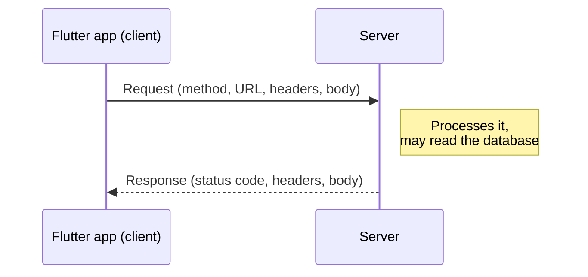
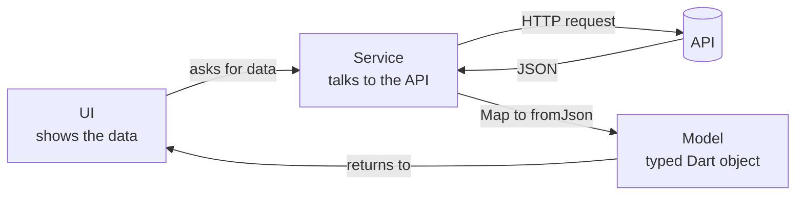

# Flutter Course: Section 6

### Networking with Dio and Local Storage with shared_preferences


Until this section, our apps only knew what was inside them, and they forgot everything when closed.
In this section they learn two new skills:

- **Remember data** on the device after the app is closed.
- **Talk to a server** to send and receive real data over the internet.

This repository has the code from the section and a summary of every main concept, so you can use it to review and study.

---

## Table of Contents

- [What's in this repository](#whats-in-this-repository)
- [How to study this section](#how-to-study-this-section)
- [Concepts summary](#concepts-summary)
  - [1. Local storage](#1-local-storage)
  - [2. Client and server](#2-client-and-server)
  - [3. REST API rules](#3-rest-api-rules)
  - [4. HTTP methods](#4-http-methods)
  - [5. Query parameters](#5-query-parameters)
  - [6. JSON and Map](#6-json-and-mapstring-dynamic)
  - [7. Status codes](#7-status-codes)
  - [8. Exceptions and error types](#8-exceptions-and-error-types)
  - [9. Models and services](#9-models-and-services)
- [Dio cheat sheet](#dio-cheat-sheet)
- [How to run the projects](#how-to-run-the-projects)
- [Check yourself](#check-yourself)
- [Resources](#resources)

---

## What's in this repository

```text
flutter-course-section-6/
├── full_shopping_app_2/     shared_preferences: save and read data on the device
├── social_media_4/          Dio demo: GET, POST, PUT, PATCH, DELETE and errors
├── wheather_app_1/          Real API: live weather with a model and a service
├── networking_notes.pdf     Reference: Dio errors, status codes, client-server communication
└── README.md                You are here
```

| Project | Main idea | API used | Read more |
| --- | --- | --- | --- |
| `full_shopping_app_2` | Saving data so it survives an app restart | None (local storage) | [README](full_shopping_app_2/README.md) |
| `social_media_4` | How requests, responses and errors work | [DummyJSON](https://dummyjson.com) (practice API) | [README](social_media_4/README.md) |
| `wheather_app_1` | Getting real data and organizing the code | [Open-Meteo](https://open-meteo.com) (real API) | [README](wheather_app_1/README.md) |

> `full_shopping_app_2` continues the project from the previous section. Here we only look at what this section added to it: `shared_preferences`.

---

## How to study this section

1. Read [`full_shopping_app_2`](full_shopping_app_2/README.md) to learn how to save data on the device.
2. Read [`social_media_4`](social_media_4/README.md), run it, and press every button to see each HTTP method in action.
3. Read [`networking_notes.pdf`](networking_notes.pdf) as your reference for status codes and error types.
4. Read [`wheather_app_1`](wheather_app_1/README.md) to see the same ideas with a real API, then do its exercise.

---

## Concepts summary

### 1. Local storage

Variables live in memory, so they disappear when the app closes. `shared_preferences` saves small **key-value** data on the device, so it is still there next time.

```dart
final pref = SharedPreferencesAsync();

await pref.setString("username", "sara");          // save
String? name = await pref.getString("username");   // read (null if not saved yet)
```

Use it for small, simple data such as settings and preferences. Do **not** use it for passwords or tokens in a real app, because it is not encrypted.

### 2. Client and server

The **client** (our app) sends a **request**. The **server** sends back a **response**. Every exchange follows this pattern.



| A request contains | A response contains |
| --- | --- |
| **Method:** GET, POST, PUT, PATCH, DELETE | **Status code:** 200, 404, 500 ... |
| **URL:** `https://dummyjson.com/posts/1` | **Headers:** Content-Type ... |
| **Headers:** Authorization, Content-Type ... | **Body:** the data (usually JSON) |
| **Body:** data we send (POST, PUT, PATCH) | |

HTTP is **stateless**: the server does not remember earlier requests, so every request must carry everything the server needs.

### 3. REST API rules

- The **URL is a noun**: it names a thing. Use `/posts`, not `/getPosts`.
- The **method is the verb**: it says what to do with that thing.
- `/posts` is the whole list, and `/posts/1` is one item chosen by its id.
- The **path** chooses the resource, and **query parameters** adjust the result.

Real APIs do not follow every rule. For example, DummyJSON creates a post with `/posts/add`. The API's documentation always has the final word.

### 4. HTTP methods

| Method | What it does | Has a body? | Example | Dio |
| --- | --- | --- | --- | --- |
| **GET** | Read data | No | `GET /posts` | `dio.get()` |
| **POST** | Create new data | Yes | `POST /posts/add` | `dio.post()` |
| **PUT** | Replace the whole item | Yes | `PUT /posts/1` | `dio.put()` |
| **PATCH** | Change part of an item | Yes | `PATCH /posts/1` | `dio.patch()` |
| **DELETE** | Remove an item | Usually no | `DELETE /posts/1` | `dio.delete()` |

**PUT or PATCH?** Think of a form. PUT sends the whole form again. PATCH sends only the fields that changed.

### 5. Query parameters

They come after `?` in the URL and are joined with `&`. We use them to filter, sort and page through data.

```text
https://dummyjson.com/posts?limit=10&skip=20
                            └── query parameters ──┘
```

With Dio, write them as a `Map` and it builds the URL for you:

```dart
await dio.get("/posts", queryParameters: {"limit": 10, "skip": 20});
```

### 6. JSON and `Map<String, dynamic>`

Servers send data as **JSON** text. Dio converts JSON to Dart for you, so `response.data` is ready to use:

| JSON | Dart |
| --- | --- |
| `{ }` object | `Map<String, dynamic>` |
| `[ ]` array | `List` |
| `"text"` | `String` |
| `10` / `10.5` | `int` / `double` |
| `true` | `bool` |

```dart
final data = response.data as Map<String, dynamic>;
final posts = data["posts"] as List;
final firstTitle = posts[0]["title"];
```

Keys are always strings, but values can be any type. That is why the type is `Map<String, dynamic>`.

### 7. Status codes

The first digit tells you the group, and who is responsible.

| Range | Meaning | Common codes |
| --- | --- | --- |
| **2xx** | Success | `200` OK, `201` Created, `204` No Content |
| **3xx** | Redirect | `301` Moved, `304` Not Modified |
| **4xx** | Client mistake: fix your request | `400` Bad Request, `401` Unauthorized, `403` Forbidden, `404` Not Found, `429` Too Many Requests |
| **5xx** | Server problem: not your fault | `500` Server Error, `502` Bad Gateway, `503` Unavailable |

**401 or 403?** 401 means "who are you?" (bad or missing token). 403 means "I know who you are, but you are not allowed."

See [`networking_notes.pdf`](networking_notes.pdf) for the full table.

### 8. Exceptions and error types

Networks fail all the time, so every request belongs in a `try` / `catch`. Dio throws a `DioException` when a request fails, **including** when the server replies with 4xx or 5xx. Its `type` tells you why it failed.

```dart
try {
  final response = await dio.get("/posts");
  // success
} on DioException catch (e) {
  print(e.type);                  // why it failed
  print(e.response?.statusCode);  // null if the server never replied
}
```

| `DioExceptionType` | What happened |
| --- | --- |
| `connectionTimeout` | Could not connect to the server in time |
| `sendTimeout` | Sending the request took too long |
| `receiveTimeout` | The server took too long to respond |
| `connectionError` | No connection (no internet, wrong host) |
| `badResponse` | The server replied with an error status code (4xx / 5xx) |
| `badCertificate` | The server's HTTPS certificate is not trusted |
| `cancel` | The request was cancelled |
| `unknown` | Any other error |

Show users a clear message such as "No internet connection" instead of a technical error.

### 9. Models and services

In a real app we organize the code so each part has one job:



- **Model:** a class that describes the data. `fromJson` turns a `Map` into an object, so we write `weather.temperature` instead of `data["current"]["temperature_2m"]`.
- **Service:** the only class that talks to the internet. The UI never uses Dio directly.
- **UI:** handles three states that every API screen needs: **loading**, **error** and **success**.

---

## Dio cheat sheet

```dart
import 'package:dio/dio.dart';

// Create once, with the shared settings
final dio = Dio(
  BaseOptions(
    baseUrl: "https://dummyjson.com",
    connectTimeout: Duration(seconds: 10),
    receiveTimeout: Duration(seconds: 10),
  ),
);

await dio.get("/posts", queryParameters: {"skip": 10});     // read
await dio.post("/posts/add", data: {"title": "hello"});     // create
await dio.put("/posts/1", data: {"title": "x", "body": "y"}); // replace
await dio.patch("/posts/1", data: {"title": "x"});          // partial update
await dio.delete("/posts/1");                               // delete

// What you get back
response.statusCode;   // 200
response.data;         // the body, already converted from JSON
```

---

## How to run the projects

You need Flutter installed with **Dart 3.13.1 or newer**. This code was written with Flutter 3.47.1.

```bash
git clone https://github.com/Atef-Mousa/flutter-course-section-6.git
cd flutter-course-section-6/social_media_4

flutter pub get
flutter run
```

To run another project, go into its folder and run the same two commands. Each folder is a separate Flutter project.

---

## Check yourself

You are ready for the next section if you can answer these without looking:

1. Why does a normal variable lose its value after the app restarts?
2. What is the difference between PUT and PATCH?
3. What is the difference between the path and the query parameters of a URL?
4. Why is the type `Map<String, dynamic>` and not `Map<String, String>`?
5. What do 4xx and 5xx tell you about who made the mistake?
6. What is the difference between `connectionError` and `badResponse`?
7. Why might `e.response` be `null` inside a `catch`?
8. What is the job of `fromJson`?
9. Why should the UI not use Dio directly in a real project?
10. What are the three states every API screen must handle?

---

## Resources

- [dio package](https://pub.dev/packages/dio)
- [shared_preferences package](https://pub.dev/packages/shared_preferences)
- [DummyJSON documentation](https://dummyjson.com/docs)
- [Open-Meteo documentation](https://open-meteo.com/en/docs)
- [HTTP status codes on MDN](https://developer.mozilla.org/en-US/docs/Web/HTTP/Status)
