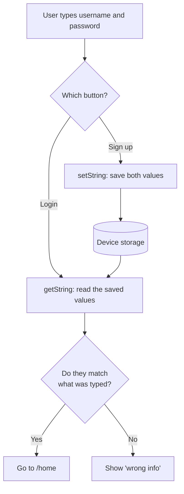

# full_shopping_app: shared_preferences

This project continues from the previous section. Here we focus on one new thing: using **`shared_preferences`** to save data on the device, so a user who signs up can still log in after closing the app.

All the code for this lesson is in `lib/login_page.dart`.

[Back to the section overview](../README.md)

---

## What you will learn

- Why variables are lost when the app closes
- What `shared_preferences` is, and when to use it
- Saving and reading data with `SharedPreferencesAsync`
- Why `await` and the `mounted` check are needed
- What you should **not** store with it

---

## The problem

Before this section, the username and password were written in the code, in a class like this:

```dart
class Database {
  static String username = "...";
  static String password = "...";
}
```

Those values are fixed, so nobody could create a new account. If we changed them while the app was running, the change would live only in **memory (RAM)** and would be lost when the app closes.

| | Variable | shared_preferences |
| --- | --- | --- |
| Stored in | Memory (RAM) | The device's storage |
| After closing the app | Lost | Still there |
| Speed | Instant | Needs `await` |

---

## What is shared_preferences?

A Flutter package that saves small pieces of data on the device as **key-value** pairs. Each value has a name (the key), and we use that name to read it later.

```text
key          value
─────────    ─────────
"username"   "sara"
"password"   "123456"
```

### Installation

```bash
flutter pub add shared_preferences
```

Then import it:

```dart
import 'package:shared_preferences/shared_preferences.dart';
```

---

## How it works in this app



### Step 1: Create the object

```dart
final _pref = SharedPreferencesAsync();
```

### Step 2: Save data (Sign up)

```dart
Future<void> _signup() async {
  var username = _usernameController.text;
  var password = _passwordController.text;

  await _pref.setString("username", username);
  await _pref.setString("password", password);

  if (!mounted) return;
  ScaffoldMessenger.of(context).showSnackBar(
    SnackBar(content: Text("signed up successfully")),
  );
}
```

`setString(key, value)` writes the value to the device. If the key already exists, its value is replaced, so signing up again overwrites the old account.

### Step 3: Read data (Login)

```dart
var realUsername = await _pref.getString("username");
var realPassword = await _pref.getString("password");

if (username == realUsername && password == realPassword) {
  // correct: go to home
}
```

`getString(key)` returns `String?`, which means it can be **`null`**. If nobody has signed up yet, the key doesn't exist and we get `null`, so the comparison is false and login fails. That is the behavior we want.

---

## Two important ideas

### Why `await`?

Reading and writing to storage takes time, so these methods return a `Future`. Without `await` you get a `Future`, not the value:

```dart
var name = _pref.getString("username");        // Future<String?>: not the value
var name = await _pref.getString("username");  // String?: the value
```

Because we use `await`, the function must be marked `async`.

### Why `if (!mounted) return`?

After an `await`, time has passed, and the user may have left the page. In that case `context` is no longer valid, and using it can crash the app. `mounted` tells us whether the widget is still on the screen, so we check it **after every `await`, before using `context`**.

```dart
await _pref.setString("username", username);

if (!mounted) return;                  // the page is gone: stop here
ScaffoldMessenger.of(context)...       // safe to use context
```

---

## All the common methods

Each data type has its own pair of methods. All of them need `await`.

| Type | Save | Read |
| --- | --- | --- |
| `String` | `setString("key", "text")` | `getString("key")` |
| `int` | `setInt("key", 10)` | `getInt("key")` |
| `double` | `setDouble("key", 1.5)` | `getDouble("key")` |
| `bool` | `setBool("key", true)` | `getBool("key")` |
| `List<String>` | `setStringList("key", ["a", "b"])` | `getStringList("key")` |

| Other methods | What it does |
| --- | --- |
| `remove("key")` | Deletes one value |
| `containsKey("key")` | Checks whether a key exists |
| `clear()` | Deletes everything |

Every read method can return `null`, so we often give a default value with `??`:

```dart
bool darkMode = await _pref.getBool("darkMode") ?? false;
```

---

## When should you use it?

| Good for | Not for |
| --- | --- |
| Theme (dark or light) | Passwords and tokens |
| Language | Large amounts of data |
| Selected city or filter | Lists of complex objects |
| "Has seen the intro" flag | Data shared between users |

> **Security warning:** `shared_preferences` is **not encrypted**. This app stores a password in it only so we can learn the package with a simple example. **Never do this in a real app.** Real apps check passwords on a server, and store tokens with a package like [`flutter_secure_storage`](https://pub.dev/packages/flutter_secure_storage). For large or structured data, use a local database.

---

## Try it yourself

**Prove that it works**

1. Run the app, type a username and a password of at least 6 characters, and press **Sign up**.
2. **Stop the app completely**, then run it again.
3. Log in with the same info. It works, because the data was saved on the device.

**Exercises**

1. **Validate sign up:** `_signup` currently saves whatever is typed, even empty text. Check the form with `_keyForm.currentState!.validate()` before saving.
2. **Save another value:** save the sign-up date as a `String`, then read it and show it on the home page.
3. **Stay logged in:** `Database.isLoggedIn` is a normal variable, so the user must log in again after every restart. Save it with `setBool`, then read it in `main()` before `runApp`. You will need `WidgetsFlutterBinding.ensureInitialized()` as the first line of `main()`.
4. **Log out:** add a button on the home page that calls `remove` on your saved login value, then goes back to `/login`.

---

## Key takeaways

- Variables live in memory, and `shared_preferences` lives on the device.
- Data is saved as key-value pairs, and each type has its own methods.
- Every call needs `await`, and read methods can return `null`.
- Check `mounted` after `await` before using `context`.
- It is for small, non-sensitive data only.

---

## Learn more

- [shared_preferences on pub.dev](https://pub.dev/packages/shared_preferences)
