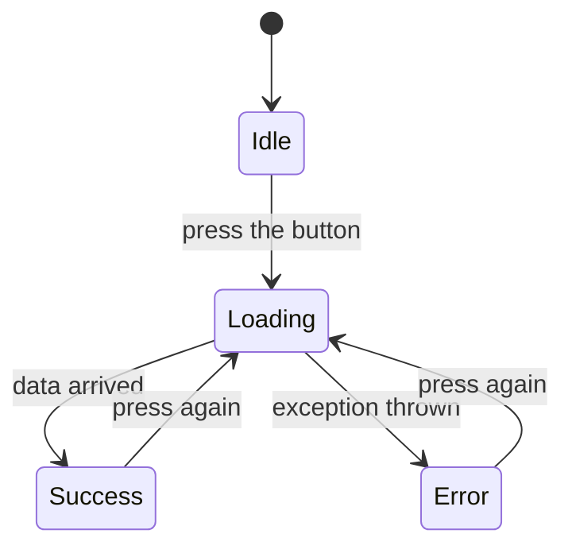

# weather_app: Working with a Real API

Pick a city, press a button, and get its **live weather**. This project uses the same Dio ideas from `social_media`, but with a real API that returns real information.

[Back to the section overview](../README.md)

---

## What you will learn

- Reading a real API's URL and documentation
- Sending a GET request with **query parameters**
- Reading the JSON that a real API returns
- Showing the **loading, error and success** states in the UI

### What changed from `social_media`?

| | `social_media` | `weather_app` |
| --- | --- | --- |
| Goal | Learn the concepts | See a real API working |
| Data | Practice data (DummyJSON) | Real, live data (Open-Meteo) |
| Methods | GET, POST, PUT, PATCH, DELETE | GET |
| Loading state | None | Spinner while waiting |

---

## Run it

```bash
flutter pub get
flutter run
```

[Open-Meteo](https://open-meteo.com) is free for non-commercial use and needs **no API key**, so the app works right away.

---

## Project structure

```text
lib/
├── main.dart              The screen
├── weather.dart           Model
└── weather_service.dart   Service: where the request is sent
```

> **Why is there a model here?** In real projects, we add an extra layer called a **model** between the JSON response and the UI. It is a good practice that helps prevent errors, such as a misspelled key or a wrong data type. That is what `weather.dart` does. We will build models properly in the next section, so for now focus on the concepts: the request and the response.

---

## Step by step

### 1. Understand the API

Every API request is just a URL. Open this one in your browser:

```text
https://api.open-meteo.com/v1/forecast?latitude=30.04&longitude=31.24&current=temperature_2m,wind_speed_10m,weather_code
```

| Part | Value | Meaning |
| --- | --- | --- |
| Base URL | `https://api.open-meteo.com/v1` | Where the API lives |
| Path | `/forecast` | Which resource we want |
| Query parameter | `latitude`, `longitude` | Which place |
| Query parameter | `current` | Which values we want |

Try changing the coordinates in your browser and see how the response changes.

The response looks like this (shortened):

```json
{
  "latitude": 30.02866,
  "longitude": 31.219194,
  "timezone": "GMT",
  "current": {
    "time": "2026-11-05T13:30",
    "temperature_2m": 27.0,
    "wind_speed_10m": 12.0,
    "weather_code": 3
  }
}
```

The server returns a lot, but we only need what is inside `current`.

### 2. Send the request

This is the same `get` we used with DummyJSON. Only the URL and the query parameters are new.

```dart
final response = await _dio.get(
  '/forecast',
  queryParameters: {
    'latitude': latitude,
    'longitude': longitude,
    'current': 'temperature_2m,wind_speed_10m,weather_code',
  },
);
```

Dio builds the same URL that you opened in the browser.

### 3. Handle the errors

A real API can fail just like any other. We catch `DioException`, check its type, and give the user a clear message:

```dart
on DioException catch (e) {
  switch (e.type) {
    case DioExceptionType.connectionTimeout:
    case DioExceptionType.receiveTimeout:
      throw Exception('The server took too long. Try again.');
    case DioExceptionType.connectionError:
      throw Exception('No internet connection.');
    case DioExceptionType.badResponse:
      throw Exception('Server error: ${e.response?.statusCode}');
    default:
      throw Exception('Something went wrong: ${e.message}');
  }
}
```

### 4. The UI: `main.dart`

Every screen that loads data can be in one of three states, so we keep three variables:

```dart
Weather? _weather;        // success: the data
bool _isLoading = false;  // loading: are we waiting?
String? _error;           // error: what went wrong
```



`_fetchWeather` moves the screen between these states:

```dart
Future<void> _fetchWeather() async {
  setState(() {
    _isLoading = true;   // show the spinner
    _error = null;       // clear the old error
  });

  try {
    final coords = _cities[_selectedCity]!;
    final weather = await _service.getCurrentWeather(
      latitude: coords[0],
      longitude: coords[1],
    );
    setState(() => _weather = weather);     // success
  } catch (e) {
    setState(() => _error = e.toString().replaceFirst('Exception: ', ''));  // error
  } finally {
    setState(() => _isLoading = false);     // always runs
  }
}
```

`finally` runs in both cases, success or failure, so the spinner can never get stuck.

`_buildResult` then picks what to show:

```dart
if (_isLoading) return const CircularProgressIndicator();
if (_error != null) return Text(_error!, ...);
if (_weather == null) return const Text('Pick a city and press the button.');
// otherwise show the weather
```

The button also uses `onPressed: _isLoading ? null : _fetchWeather`. A `null` value disables it, so the user can't send the same request twice.

---

## Break it on purpose

The best way to understand errors is to cause them. Try each one, read the message, then undo the change.

| Do this | Where | Message you should see |
| --- | --- | --- |
| Turn off your internet | Your device | No internet connection. |
| Change `'/forecast'` to `'/forecastt'` | `weather_service.dart` | Server error: 404 |
| Set `connectTimeout` to `Duration(milliseconds: 1)` | `weather_service.dart` | The server took too long. Try again. |

---

## Exercise: add humidity

Show the humidity on the screen. Open-Meteo calls this value `relative_humidity_2m`.

1. Open the URL in your browser, add `relative_humidity_2m` to `current`, and look at what comes back.
2. Add the same value to the `current` query parameter in `weather_service.dart`.
3. Read the value in `weather.dart` the same way as the other values, then show it with a `Text` in `main.dart`.

**More practice**

- Add a new city to the `_cities` map.
- Show a "Try again" button when there is an error.
- Save the selected city with `shared_preferences`, so the app remembers it after a restart.

---

## Key takeaways

- A real API works just like the practice one: URL, method, status code, JSON.
- Read the documentation to learn which parameters and keys exist.
- The UI should always handle loading, error and success.
