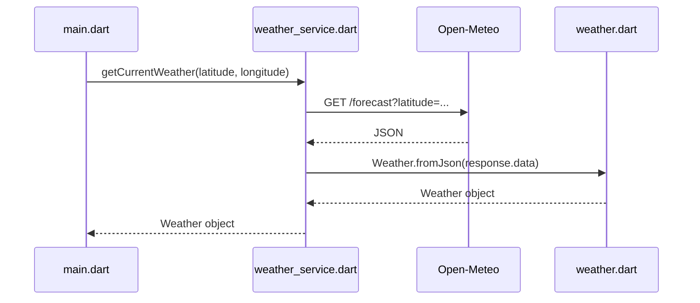
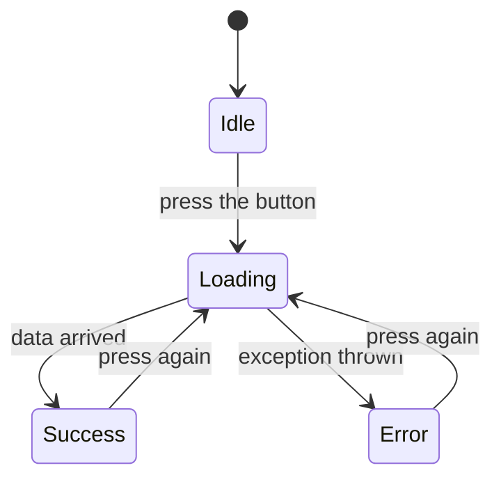

# wheather_app_1: Working with a Real API

Pick a city, press a button, and get its **live weather**. This project uses the same Dio ideas from `social_media_4`, but with real data and cleaner code.

[Back to the section overview](../README.md)

---

## What you will learn

- Reading a real API's URL and documentation
- Sending a GET request with **query parameters**
- Converting JSON into a **model class** with `fromJson`
- Keeping network code in a **service class**
- Showing the **loading, error and success** states in the UI

### What changed from `social_media_4`?

| | `social_media_4` | `wheather_app_1` |
| --- | --- | --- |
| Goal | Learn the concepts | Build it the right way |
| Data | Practice data (DummyJSON) | Real, live data (Open-Meteo) |
| Methods | GET, POST, PUT, PATCH, DELETE | GET |
| Files | Everything in `main.dart` | Model, service and UI are separate |
| Reading data | `data["posts"][0]["title"]` | `weather.temperature` |
| Loading state | None | Spinner while waiting |

---

## Run it

```bash
flutter pub get
flutter run
```

[Open-Meteo](https://open-meteo.com) is free for non-commercial use and needs **no API key**, so the app works right away.

---

## Project structure

```text
lib/
├── main.dart              UI: the screen and its three states
├── weather.dart           Model: describes the data, fromJson
└── weather_service.dart   Service: the only file that talks to the internet
```



---

## Step by step

### 1. Understand the API

Every API request is just a URL. Open this one in your browser:

```text
https://api.open-meteo.com/v1/forecast?latitude=30.04&longitude=31.24&current=temperature_2m,wind_speed_10m,weather_code
```

| Part | Value | Meaning |
| --- | --- | --- |
| Base URL | `https://api.open-meteo.com/v1` | Where the API lives |
| Path | `/forecast` | Which resource we want |
| Query parameter | `latitude`, `longitude` | Which place |
| Query parameter | `current` | Which values we want |

Try changing the coordinates in your browser and see how the response changes.

The response looks like this (shortened):

```json
{
  "latitude": 30.02866,
  "longitude": 31.219194,
  "timezone": "GMT",
  "current": {
    "time": "2026-11-05T13:30",
    "temperature_2m": 27.0,
    "wind_speed_10m": 12.0,
    "weather_code": 3
  }
}
```

The server returns a lot, but we only need what is inside `current`.

### 2. The model: `weather.dart`

The model describes the data we care about. `fromJson` takes the `Map` and builds a typed object.

```dart
class Weather {
  final double temperature;
  final double windSpeed;
  final int weatherCode;
  final String time;

  Weather({
    required this.temperature,
    required this.windSpeed,
    required this.weatherCode,
    required this.time,
  });

  static Weather fromJson(Map<String, dynamic> json) {
    final current = json['current'];

    return Weather(
      temperature: (current['temperature_2m'] as num).toDouble(),
      windSpeed: (current['wind_speed_10m'] as num).toDouble(),
      weatherCode: current['weather_code'] as int,
      time: current['time'] as String,
    );
  }
}
```

**Why a model?** The rest of the app writes `weather.temperature` instead of `data['current']['temperature_2m']`. The editor now knows the type, offers autocomplete, and shows typos before the app runs. If the API changes a key, only `fromJson` needs fixing.

**Why `as num` and then `.toDouble()`?** JSON has just one number type. The server may send `27.0` (a Dart `double`) or `27` (a Dart `int`). `num` accepts both, then `.toDouble()` gives us a `double` every time.

The model can also hold logic. The API sends a number, and the `description` getter turns it into text the user can read:

```dart
String get description => switch (weatherCode) {
      0 => 'Clear sky ',
      1 || 2 || 3 => 'Partly cloudy',
      // ...
      _ => 'Unknown',
    };
```

### 3. The service: `weather_service.dart`

This class is the **only** place that talks to the internet.

```dart
Future<Weather> getCurrentWeather({
  required double latitude,
  required double longitude,
}) async {
  try {
    final response = await _dio.get(
      '/forecast',
      queryParameters: {
        'latitude': latitude,
        'longitude': longitude,
        'current': 'temperature_2m,wind_speed_10m,weather_code',
      },
    );

    return Weather.fromJson(response.data);
  } on DioException catch (e) {
    switch (e.type) {
      case DioExceptionType.connectionTimeout:
      case DioExceptionType.receiveTimeout:
        throw Exception('The server took too long. Try again.');
      case DioExceptionType.connectionError:
        throw Exception('No internet connection.');
      case DioExceptionType.badResponse:
        throw Exception('Server error: ${e.response?.statusCode}');
      default:
        throw Exception('Something went wrong: ${e.message}');
    }
  }
}
```

Notice the job of this function:

- **In:** coordinates. **Out:** a `Weather` object. The UI never sees JSON or Dio.
- It catches the technical `DioException` and throws a new `Exception` with a friendly message, which the UI can display directly.

### 4. The UI: `main.dart`

Every screen that loads data can be in one of three states, so we keep three variables:

```dart
Weather? _weather;        // success: the data
bool _isLoading = false;  // loading: are we waiting?
String? _error;           // error: what went wrong
```



`_fetchWeather` moves the screen between these states:

```dart
Future<void> _fetchWeather() async {
  setState(() {
    _isLoading = true;   // show the spinner
    _error = null;       // clear the old error
  });

  try {
    final coords = _cities[_selectedCity]!;
    final weather = await _service.getCurrentWeather(
      latitude: coords[0],
      longitude: coords[1],
    );
    setState(() => _weather = weather);     // success
  } catch (e) {
    setState(() => _error = e.toString().replaceFirst('Exception: ', ''));  // error
  } finally {
    setState(() => _isLoading = false);     // always runs
  }
}
```

`finally` runs in both cases, success or failure, so the spinner can never get stuck.

`_buildResult` then picks what to show:

```dart
if (_isLoading) return const CircularProgressIndicator();
if (_error != null) return Text(_error!, ...);
if (_weather == null) return const Text('Pick a city and press the button.');
// otherwise show the weather
```

The button also uses `onPressed: _isLoading ? null : _fetchWeather`. A `null` value disables it, so the user can't send the same request twice.

---

## Break it on purpose

The best way to understand errors is to cause them. Try each one, read the message, then undo the change.

| Do this | Where | Message you should see |
| --- | --- | --- |
| Turn off your internet | Your device | No internet connection. |
| Change `'/forecast'` to `'/forecastt'` | `weather_service.dart` | Server error: 404 |
| Set `connectTimeout` to `Duration(milliseconds: 1)` | `weather_service.dart` | The server took too long. Try again. |

---

## Exercise: add humidity

Show the humidity on the screen. Open-Meteo calls this value `relative_humidity_2m`.

1. Open the URL in your browser and add the new value to `current` to see what comes back.
2. **Service:** add it to the `current` query parameter.
3. **Model:** add a `humidity` field and read it in `fromJson`.
4. **UI:** add a `Text` that shows `w.humidity`.

Notice that each file changed for its own reason. That is the benefit of this structure.

**More practice**

- Add a new city to the `_cities` map.
- Show a "Try again" button when there is an error.
- Save the selected city with `shared_preferences`, so the app remembers it after a restart.

---

## Key takeaways

- A real API works just like the practice one: URL, method, status code, JSON.
- Read the documentation to learn which parameters and keys exist.
- **Model:** turns JSON into a typed object.
- **Service:** keeps all network code in one place.
- **UI:** always handles loading, error and success.
